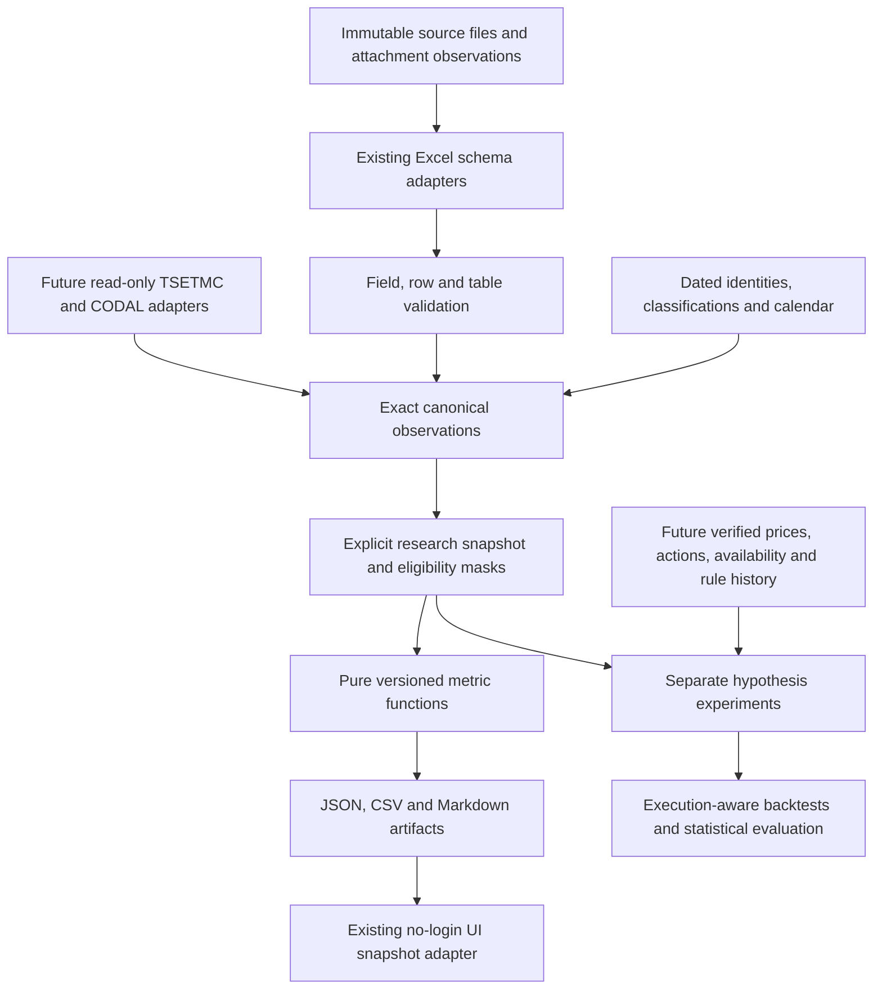

# Iranian market research platform: proposed design

**Status: proposal for user approval.** Research and reference skills are authorized; new analytical behavior, storage migrations and UI changes are not implemented by this document. First milestone only; later research/enrichment/backtesting subsystems require their own scoped designs.

## Problem and intended outcome

The current no-login archive can read heterogeneous investor-category Excel files and selectively retain valid fields. It now needs a disciplined way to discover useful methods, distinguish supported calculations from untested financial claims, and turn a small number into reproducible research artifacts. A familiar indicator must not be treated as a trading edge without relevant data and validation.

The first deliverable after approval is a deterministic **ownership-transfer and concentration research snapshot** generated from the actual `KH - 14050819.xlsx` and a small optional set of compatible historical reports. It will explain investor transfer, breadth, concentration and counterflow structure with rankings and source/coverage diagnostics. It will not produce return forecasts, buy/sell recommendations, fabricated participant counts, sector labels or a trading backtest.

## Approaches considered

| Approach | Benefit | Cost / weakness | Decision |
|---|---|---|---|
| **Extend the existing modular monolith** with pure metric functions, exact observations and reproducible reports | Reuses tested downloads/header detection/SQLite/UI; small end-to-end milestone; fewer moving parts | Requires deliberate boundaries around a growing parser and approximate serving tables | **Recommended** |
| Replace ingestion/storage with pandas/DuckDB and a new web/API stack | Convenient large research joins and notebooks; useful if scale grows substantially | New dependencies, data migration and duplicated logic before the research question is settled | Reconsider after measured bottlenecks; no rewrite now |
| Build broad TSETMC/CODAL enrichment and a strategy engine first | Eventually enables many catalog candidates | Identity, timestamps, actions and execution semantics are unverified; high chance of a plausible but invalid backtest | Research backlog; pilot adapters after descriptive milestone |

## Global constraints

- Python 3.10+; the first milestone adds no external runtime dependency.
- Preserve raw bytes and source text; Excel, local databases, downloaded evidence and generated reports remain ignored by Git.
- Financial core calculations use Decimal from exact source amounts; missing/invalid inputs produce null with a reason, never invented zero.
- Every metric declares its unit, formula version, scope, denominator, eligibility mask, exclusions and provenance.
- Unknown instrument identity/classification stays explicit; suffixes are never merged by heuristic.
- Unverified publication timezone or historical versions restrict data to descriptive use; no executable predictive/backtest claims.
- Keep the current no-login app working; no unrelated rewrite; reuse the existing UI design for the first milestone snapshot views.
- Source warnings do not discard independently checked fields; incomplete-table sums are not full-market totals.
- Numerical output is computed by tested code; an LLM may explain evidence but never supply financial numbers.

## Modular boundaries

### Source ingestion and normalization

Keep `scripts/download_reports.py` and `scripts/workbook_layout.py` authoritative for existing downloading and header detection. Add an observation adapter rather than duplicating Excel parsing. It preserves originals, header groups, sheet/row/cell, source amounts and scoped warnings. Persian matching normalization does not destroy displayed text; Jalali/Gregorian and timezone conversion rules are explicit and tested.

Daily ownership, monthly summaries and market reviews are separate report families. Hidden/BI templates are auxiliary sources with possible overlaps, omissions and different percent scales; they are not automatically added to visible tables. Their future adapters require independent reconciliation.

### Instrument identity and classification

Initially `source_symbol` plus workbook/session is an exact-label key and `instrument_id`/type/sector are null. Future resolution produces a dated mapping with match method, confidence and unresolved state, keeping issuer versus security versus trading channel separate. Current unknown/mixed instruments are labeled “reported instruments,” not “all Iranian stocks.”

### Validation and exact canonical storage

Continue using the existing per-field, per-row, per-measure and per-table checks. Separate `source_status` from `metric_eligibility`. Store exact Decimal text/units and all input observation IDs. Current REAL serving columns are not the source for new financial calculations.

The first milestone can use immutable JSON artifacts over parsed exact observations; it does not require a database migration. Later persistence should add versioned `source_observations`, `instrument_aliases`, `metric_definitions`, `metric_runs`, `metric_values`, and `research_experiments` rather than replacing working tables. Provenance must include raw publication text, its timezone confidence, collector observation time, revision relationships and parsed availability time only where verified.

Current `active_reports` and `symbol_reports` are retrospective serving views. A future as-of resolver must select revisions actually available at a requested cutoff; current “best/latest revision” SQL cannot support a historical trading decision. Same-byte republishing events need append-only observations even when the binary content is deduplicated.

### Pure financial calculations

Introduce `tse_research/metrics/` with no network, SQL or UI side effects. Each function consumes explicit eligible observations and returns a result envelope with a value or null, reason, units, denominator/coverage and formula version. Aggregate functions must receive a declared compatible population and completeness evidence.

A metric registry records rationale/evidence class and required inputs. Existing correct calculations are reused or wrapped with tests before any extraction/refactor. Experiments do not silently replace production metric definitions.

### Experiments, enrichment and backtesting

Keep future `experiments/`, `enrichment/`, `backtesting/` and `evaluation/` boundaries outside the initial implementation. Their contracts require point-in-time inputs, action-aware returns, chronological splits, recorded trial counts, costs and execution states. A model must produce deterministic, reviewable outputs before any optional LLM explanation. No live trading or broker integration is in scope.

### Reporting and interface

First milestone: CLI writes deterministic JSON/CSV/Markdown plus a provenance manifest under ignored `reports/research/`. Markdown explains each number, its scope and its limits; rankings state their sort key and missing-data exclusions. Repeating identical input bytes, parameters and metric versions produces identical analytical artifacts. Wall-clock run metadata is separate from the deterministic calculation payload.

The first milestone includes a small API/UI adapter reading approved artifacts. Add Research snapshot navigation and links from report detail/library entries. The view shows the selected source/date, completeness and exclusions, the four metric families, ranked contributors, definitions/provenance and JSON/CSV/Markdown downloads. Existing source library, Parsed CSV, validation disclosures and no-login flow remain available. No browser calculation replaces server results. A missing artifact is an explicit not-generated state, not a fabricated zero; the CLI generates artifacts offline. The current report library remains the selector for the wider archive; first-slice analytics are available for generated artifacts, initially the actual sample. See the UI task in the implementation plan for route and accessibility contracts.

## First milestone metric contract

Let an eligible instrument have retail buy/sell value `RB, RS`, institutional buy/sell `IB, IS`, and matched turnover `T=RB+IB≈RS+IS`. All amounts are in rial. Record residual R=(RB+IB)−(RS+IS); N+(IB−IS)=R, so opposite category nets are exact only when R=0. Existing row tolerances remain explicit; report any nonzero residual. A tolerated row is not automatically eligible for a bounded intensity: if T<=0 or |N|>T, return null with a reason, never clamp. Retain its independently checked raw values and unnormalized transfer with residual diagnostics. Market-level metrics use a complete checked value table; partial tables supply only labeled symbol observations.

| Family | Formula | Interpretation and limits |
|---|---|---|
| Ownership transfer and intensity | `N=RB−RS`; institutional counterpart `IB−IS`; `I=N/T` for `T>0` | Transfer between categories, not new aggregate cash; a ratio can be large in a tiny instrument. Existing behavior is wrapped, not reinvented. |
| Flow breadth | `B=(n_positive−n_negative)/(n_positive+n_negative)` when denominator >0; unchanged/missing counts separate | Direction across reported instruments; not price advance/decline breadth, and changing coverage can change it. |
| Turnover concentration | `s_i=T_i/ΣT`; `HHI=Σs_i²`; `N_eff=1/HHI`; top-k share | Established concentration math applied descriptively to trading value. No antitrust thresholds, effective-investor-count interpretation or predictive claim. |
| Cross-instrument counterflow structure | `G=Σ\|N_i\|`; `C=1−\|ΣN_i\|/G` when `G>0` | Descriptive cancellation of category transfers across instruments: 0 aligned, 1 fully offset. This named accounting construction is not a validated trading signal or unique statistic independent of its inputs. |

Undefined denominators return null with reasons. For all-zero turnover, concentration/effective count are null. For all-zero transfers, cancellation is null, not 1. Ranking tables show positive/negative net transfers and turnover contributions; normalized intensity is shown alongside absolute turnover. No opaque combined “smart money” score is introduced.

**Independent hand fixture:** two instruments with `(RB,IB,RS,IS)=(60,40,30,70)` and `(120,180,130,170)` have turnover `(100,300)`, nets `(30,−10)`, aggregate net `20`, intensity `0.05`, flow breadth `0`, turnover HHI `0.625`, effective count `1.6`, gross transfer `40`, cancellation `0.5`. These are defined arithmetic expectations, not learned coefficients.

**Real source anchors:** 1,192 sample instruments; turnover `596948215456567` rial; retail net `74101817413833` rial; quantity `52177504941` only when the matching volume table is independently complete. New metrics receive independent reference calculations and invariance tests before reporting results.

## Historical extension gate

After the snapshot is accepted, add one historical question: “Is this instrument's observed transfer intensity or trading-value share unusual relative to its previous compatible observations?” Use trailing observations excluding the current one, explicit minimum history, observed-session dates and robust median/MAD with a zero-MAD policy. Changing-population market comparisons use matched panels and report entries/exits. This is descriptive anomaly detection; usefulness for forecasting needs a later return dataset and preregistered evaluation.

## Acceptance and review

1. Current parser/regression anchors remain correct, including reversed roles, missing fields, duplicate quarantine and source warnings.
2. Each calculation has hand-worked fixtures, zero/missing/invalid cases, units, identity and permutation/scale invariants. No tests merely duplicate implementation code.
3. New metrics use exact parsed amounts, not SQL REAL values; all rankings have deterministic ties and declared sort keys.
4. Full sample report traces every metric to source hash, dates, row eligibility, population, unit and formula version.
5. A partial or contradictory workbook cannot create a complete-market total; independently valid fields remain inspectable.
6. Duplicate revisions are not double-counted. No publication timestamp is relabeled as a trading date or assumed timezone.
7. Independent numerical/financial review resolves material issues; the report clearly separates descriptive observations from unsupported hypotheses.

## Approval requested

Approve the recommended modular extension and **only the first snapshot milestone** above. The detailed execution plan is a reviewable proposal in `docs/superpowers/plans/2026-11-11-ownership-research-snapshot.md`. Enrichment, predictive models, strategies, additional UI expansion and storage migrations remain future milestones with separate data/validation gates.
